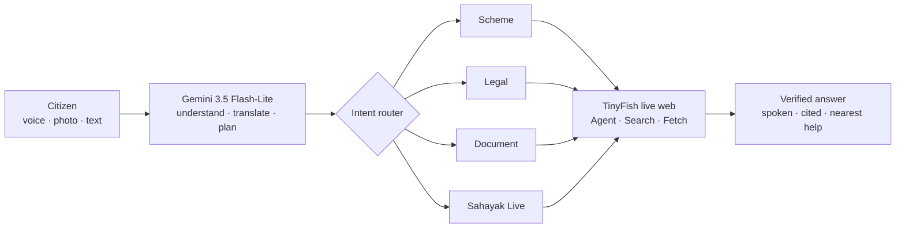

# Nyaya Setu (न्याय सेतु) — AI Bridge to Rights & Justice

**Speak in your language. Watch AI do it on the government website.**

Nyaya Setu is a free, voice-first, multilingual Android app that helps Indian citizens discover welfare schemes, navigate legal processes and understand official documents — and then **verifies every answer live on official `.gov.in` websites**. Google **Gemini** understands the citizen; **TinyFish** browses, reads and acts on the live web for them.

Built by **Team Hackpeeps**.

---

## Why it exists

Citizens don't lack schemes or laws — they lack a simple, trustworthy way to reach them:

- **Language wall** – India has 22 scheduled languages, but most portals and notices use only English or formal Hindi.
- **Literacy wall** – about 1 in 4 rural adults cannot read fluently (rural literacy 77%, PLFS 2023–24).
- **Middleman wall** – agents charge ₹200–2,000 to fill forms that are legally free.
- **Scam wall** – cyber-fraud complaints grew from 10.3 lakh (2022) to 22.7 lakh (2024), and losses to ₹22,846 crore in 2024 (MHA / NCRP).
- **Stale information** – rules change; people rely on unverified forwards.

## Features (13)

| Group | Feature | What it does |
|---|---|---|
| Core (Gemini) | **Scheme Navigator** | Describe your life in your own words (voice or text) → matching schemes, eligibility cues, documents needed. |
| | **Legal Companion** | FIR, RTI, land, family, cyber fraud, wages → plain-language steps + free legal aid (DLSA) routing. |
| | **Document Simplifier** | Photograph any notice → 3 simple points, actions and deadlines (Gemini Vision, no OCR). |
| Live web (TinyFish) | **🛰️ Sahayak Live** | Speak a task → an AI cloud browser opens the official site and does it **live inside the app**, with a step timeline. |
| | **✅ Verify Live** | One tap under any answer → cross-checked against official pages → *Verified / Updated / Partial* + sources. |
| | **🛡️ Scam Shield** | Paste or photograph an SMS / notice → *Genuine / Suspicious / Likely SCAM* + 1930 helpline guidance. |
| | **📍 Real Help Centres** | GPS → city → real CSC, DLSA, police and One Stop Centres with Call / Directions. |
| | **📰 Live Updates** | This week's scheme & fraud-alert news, translated. |
| Access for all | **13 Indian languages** | Full UI + replies in English, Hindi, Marathi, Bengali, Telugu, Tamil, Gujarati, Urdu, Kannada, Odia, Malayalam, Punjabi, Assamese. |
| | **Read aloud** | Every answer spoken, adjustable speed. |
| | **Voice Translator** | Speak in one language, hear another. |
| | **Visual Solver** | Photograph anything and ask about it. |
| | **Saved history** | Conversations stay on the phone. |

## Architecture



### Role of AI (Gemini)
One multimodal model performs six jobs: speech understanding (13 languages, no separate STT), document vision, intent classification, browser-task planning (JSON), grounded verification against live pages, and scam classification. Structured tasks run in JSON mode at temperature 0.2, with automatic retry when the AI service is busy. **AI plans and explains; facts come from live official websites.**

### TinyFish integration
All three APIs sit behind one resilient client — `src/services/tinyfishApi.js` (REST client) and `src/services/liveIntel.js` (TinyFish + Gemini orchestration).

| API | Endpoint | Powers |
|---|---|---|
| **Agent** | `POST /v1/automation/run-async`, `GET /v1/runs/{id}`, `POST /v1/runs/{id}/cancel` | Sahayak Live — live `streaming_url` shown in a WebView, polled every 2 s, auto-stops at 150 s, user can stop anytime |
| **Search** | `GET api.search.tinyfish.ai` | Verify Live, Scam Shield, Help Centres, Live Updates — India-located, `.gov.in` / `.nic.in` ranked first, 7-day news window |
| **Fetch** | `POST api.fetch.tinyfish.ai` | Verify Live & quick answers — official pages as clean markdown, cited |

**Resilience:** Sahayak Live gives a quick Search + Fetch answer (~15 s) while the agent works in parallel; captcha / block detection falls back automatically; help centres are cached 24 h and news 6 h.

### Safety & privacy
- **Read-only agent** — never logs in, enters Aadhaar / OTP / bank details, pays or submits.
- **Data stays on the phone** — history and settings in on-device storage; no user database.
- **Official-first & cited** — sources shown so citizens can check themselves.
- **Liability-safe legal help** — general guidance + "confirm with a lawyer or your nearest DLSA".

## Tech stack

| Layer | Technology |
|---|---|
| App | React Native 0.86 · React 19.2 · **Expo SDK 57** |
| Navigation | React Navigation 7 (bottom tabs + native stack) |
| AI | Google Gemini `gemini-3.5-flash-lite` (text, image and audio in one API) |
| Live web | TinyFish Agent, Search & Fetch APIs · `react-native-webview` for the live view |
| Voice | `expo-audio` (recording) · `expo-speech` (text-to-speech) |
| Device | `expo-image-picker` (camera) · `expo-location` (GPS) · `expo-file-system` |
| Storage | `@react-native-async-storage/async-storage` |
| Build | EAS Build (Android APK) |

## Project structure

```
App.js / index.js          navigation + app entry
src/screens/               Home, Scheme Navigator, Legal Companion, Document Simplifier,
                           Sahayak Live, Help Centres, Translator, Visual Solver, Settings
src/services/geminiApi.js  Gemini client (text, image, audio, JSON) with retry
src/services/tinyfishApi.js TinyFish Agent / Search / Fetch client (+ demo mode)
src/services/liveIntel.js  Verify Live, Scam Shield, Help Centres, Live Updates, Sahayak Live
src/components/            AgentLiveView (live browser), LiveCard, chat UI
src/utils/                 voiceRecorder, speaker, language helpers, chat storage
src/data/                  schemes, legal scenarios, 13-language translations
scripts/diagnose-sahayak.sh  checks Gemini + all 3 TinyFish APIs from the terminal
```

## Setup

**Requirements:** Node.js 20.19.4+ (or 22.13+ / 24.3+), an Android phone with **Expo Go (SDK 57)**, a [Gemini API key](https://aistudio.google.com/apikey) and a [TinyFish API key](https://agent.tinyfish.ai/api-keys).

```bash
git clone https://github.com/satvikjain2507-star/Nyaya-Setu.git
cd Nyaya-Setu
npm install
cp .env.example .env      # then paste your two keys into .env
npx expo start --clear    # scan the QR code with Expo Go (same Wi-Fi / hotspot)
```

`.env`:
```
EXPO_PUBLIC_GEMINI_API_KEY=your_gemini_api_key_here
EXPO_PUBLIC_TINYFISH_API_KEY=your_tinyfish_api_key_here
EXPO_PUBLIC_USE_RN_FETCH=1
```
Without keys the app runs in **demo mode** with sample data, so it never breaks during a presentation.

**Check the APIs:** `bash scripts/diagnose-sahayak.sh` (prints only HTTP status, never your keys).

## Build the Android APK

```bash
npm install -g eas-cli
eas login
eas build -p android --profile preview
```
EAS prints a download link / QR code for the `.apk` when the build finishes.

## Troubleshooting

| Problem | Fix |
|---|---|
| Expo Go says *incompatible SDK* | Install Expo Go for SDK 57 (press `a` in the Expo terminal with the phone connected). |
| `failed to start tunnel` | Skip `--tunnel`; put phone and computer on the same Wi-Fi / hotspot. |
| Gemini `503` | Google's servers are busy — the app retries automatically; try again in a minute. |
| TinyFish `403 … custom max steps` | Custom `agent_config` needs TinyFish beta access; the app already sends only supported fields. |

## Roadmap
Pilot with CSCs, NGOs and DLSA → WhatsApp bot and IVR/SMS for feature phones → all 22 scheduled languages, iOS and consent-based form filling.

---
*Nyaya Setu provides general information and guidance only — not legal advice. Always confirm with official sources or your nearest District Legal Services Authority.*
