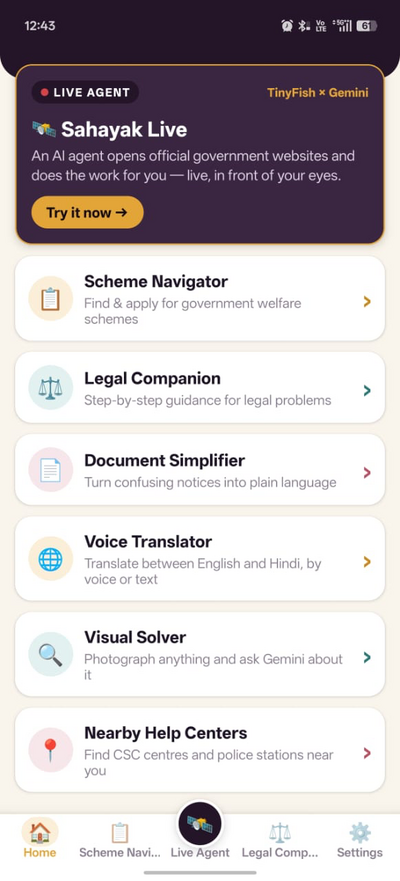
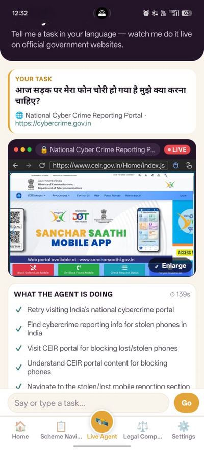
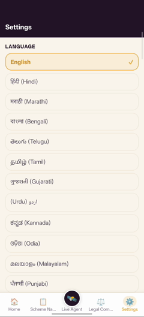
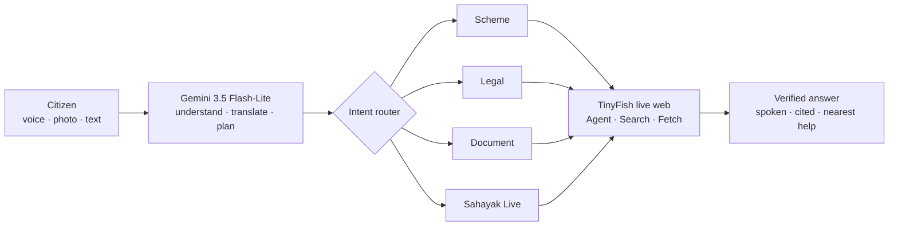
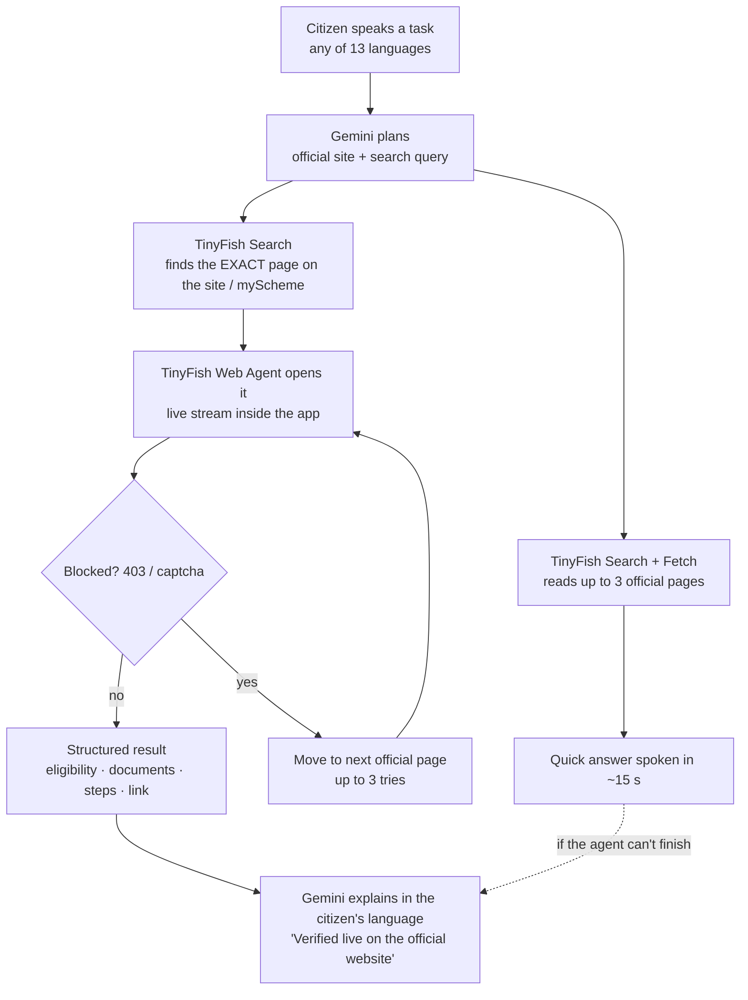

# Nyaya Setu (न्याय सेतु) — AI Bridge to Rights & Justice

**Speak in your language. Watch AI do it on the government website.**

Nyaya Setu is a free, voice-first, multilingual Android app that helps Indian citizens discover welfare schemes, navigate legal processes and understand official documents — and then **verifies every answer live on official `.gov.in` websites**. Google **Gemini** understands the citizen; **TinyFish** browses, reads and acts on the live web for them.

Built by **Team Hackpeeps**.

> 🎬 **Demo video:** _add your video link here_  ·  📱 **Android APK:** built with EAS (see [Build](#build-the-android-apk))

<p align="center">
  
  
  
</p>
<p align="center"><i>Home · Sahayak Live (TinyFish agent live on ceir.gov.in for a stolen phone) · 13 languages</i></p>

---

## Why it exists

Citizens don't lack schemes or laws — they lack a simple, trustworthy way to reach them:

- **Language wall** – India has 22 scheduled languages, but most portals and notices use only English or formal Hindi.
- **Literacy wall** – about 1 in 4 rural adults cannot read fluently (rural literacy 77%, PLFS 2023–24).
- **Middleman wall** – agents charge ₹200–2,000 to fill forms that are legally free.
- **Scam wall** – cyber-fraud complaints grew from 10.3 lakh (2022) to 22.7 lakh (2024), and losses to ₹22,846 crore in 2024 (MHA / NCRP).
- **Stale information** – rules change; people rely on unverified forwards.

## Features (13)

| Group | Feature | What it does |
|---|---|---|
| Core (Gemini) | **Scheme Navigator** | Describe your life in your own words (voice or text) → matching schemes, eligibility cues, documents needed. |
| | **Legal Companion** | FIR, RTI, land, family, cyber fraud, wages → plain-language steps + free legal aid (DLSA) routing. |
| | **Document Simplifier** | Photograph any notice → 3 simple points, actions and deadlines (Gemini Vision, no OCR). |
| Live web (TinyFish) | **🛰️ Sahayak Live** | Speak a task → an AI cloud browser opens the official site and does it **live inside the app**, with a step timeline. |
| | **✅ Verify Live** | One tap under any answer → cross-checked against official pages → *Verified / Updated / Partial* + sources. |
| | **🛡️ Scam Shield** | Paste or photograph an SMS / notice → *Genuine / Suspicious / Likely SCAM* + 1930 helpline guidance. |
| | **📍 Real Help Centres** | GPS → city → real CSC, DLSA, police and One Stop Centres with Call / Directions. |
| | **📰 Live Updates** | This week's scheme & fraud-alert news, translated. |
| Access for all | **13 Indian languages** | Full UI + replies in English, Hindi, Marathi, Bengali, Telugu, Tamil, Gujarati, Urdu, Kannada, Odia, Malayalam, Punjabi, Assamese. |
| | **Read aloud** | Every answer spoken, adjustable speed. |
| | **Voice Translator** | Speak in one language, hear another. |
| | **Visual Solver** | Photograph anything and ask about it. |
| | **Saved history** | Conversations stay on the phone. |

## Architecture



### Role of AI (Gemini)
One multimodal model performs six jobs: speech understanding (13 languages, no separate STT), document vision, intent classification, browser-task planning (JSON), grounded verification against live pages, and scam classification. Structured tasks run in JSON mode at temperature 0.2, with automatic retry when the AI service is busy. **AI plans and explains; facts come from live official websites.**

### TinyFish integration — the "hands" of Nyaya Setu
TinyFish is what turns Nyaya Setu from a chatbot into an agent that **works on the live web**. It powers 5 of the 13 features. All three APIs sit behind one resilient client: `src/services/tinyfishApi.js` (REST client) and `src/services/liveIntel.js` (TinyFish + Gemini orchestration).

| API | Endpoint | Powers |
|---|---|---|
| **Web Agent** | `POST /v1/automation/run-async`, `GET /v1/runs/{id}`, `POST /v1/runs/{id}/cancel` | **Sahayak Live**: a cloud browser opens the official site and does the task. Its `streaming_url` plays live inside the app, with a step timeline. Polled every 2 s; the user can stop anytime. |
| **Search** | `GET api.search.tinyfish.ai` | Finds the **exact official page** for Sahayak Live, plus Verify Live, Scam Shield, Real Help Centres and Live Updates. India-located; `.gov.in` / `.nic.in` ranked first; 7-day window for news. |
| **Fetch** | `POST api.fetch.tinyfish.ai` | Reads official pages as clean markdown for Verify Live and the quick answer; every answer cites its source. |

#### How a Sahayak Live task runs


- **Deep-link start.** Starting the agent on the exact scheme page instead of a home page cut a live test run from **94 s to 52 s** (same PMAY-Urban task, TinyFish server timestamps).
- **Knows which government sites block cloud browsers.** We tested 20 official hosts. The ones that return 403 or time out (e.g. `beneficiary.nha.gov.in`, `pmjay.gov.in`, `nfsa.gov.in`) are in `CLOUD_BLOCKED` and never chosen; the agent is sent to a reachable official page instead (e.g. `myscheme.gov.in/schemes/ab-pmjay`).
- **Never stuck, never empty-handed.** If an early step shows 403 / captcha / a blank page, the run is cancelled and restarted on the next official page. A quick Search + Fetch answer from the same official sources is always ready.
- **Read-only and official-only by design.** Every agent goal says: never log in, never type personal details, never submit forms or pay, and never leave `.gov.in` / `.nic.in` websites.
- **Cost-aware.** Help centres are cached for 24 h and news for 6 h; agent runs happen only when the citizen asks.

Excerpt of the goal the app sends to the TinyFish Web Agent (`buildGoal` in `liveIntel.js`):
```text
You are already on the official page that should contain the answer. Work fast:
1. If a pop-up, cookie banner or language selector appears, close it.
2. Read the page. Scroll down. If it has tabs (Benefits, Eligibility, Documents Required,
   Application Process, FAQ), click each relevant tab and read it.
3. Only if this page does not answer the task, click at most ONE relevant link on the same site.
4. Never log in, never type personal details, never submit forms, never pay, and never
   leave official .gov.in / .nic.in websites.
Return JSON: title, summary, eligibility, benefits, documents[], steps[], fees, helpline, official_link.
If the page shows 403 / Forbidden / a captcha / stays blank, return {"blocked": true}.
```

| Feature | TinyFish APIs used | What the citizen gets |
|---|---|---|
| 🛰️ Sahayak Live | Search → Web Agent (+ Fetch for the quick answer) | Watches AI do the task on the official site; spoken answer + official link |
| ✅ Verify Live | Search + Fetch | Any AI answer checked against live official pages: *Verified / Updated / Partial*, with sources |
| 🛡️ Scam Shield | Search (web + news) | Fake notice / SMS check against official sources and fraud alerts → *Genuine / Suspicious / Likely SCAM* |
| 📍 Real Help Centres | Search | Real CSC, DLSA, police and One Stop Centres for the user's GPS city |
| 📰 Live Updates | Search (news, last 7 days) | This week's scheme and fraud-alert news, translated |

### Safety & privacy
- **Read-only agent** — never logs in, enters Aadhaar / OTP / bank details, pays or submits.
- **Data stays on the phone** — history and settings in on-device storage; no user database.
- **Official-first & cited** — sources shown so citizens can check themselves.
- **Liability-safe legal help** — general guidance + "confirm with a lawyer or your nearest DLSA".

## Tech stack

| Layer | Technology |
|---|---|
| App | React Native 0.86 · React 19.2 · **Expo SDK 57** |
| Navigation | React Navigation 7 (bottom tabs + native stack) |
| AI | Google Gemini `gemini-3.5-flash-lite` (text, image and audio in one API) |
| Live web | TinyFish Agent, Search & Fetch APIs · `react-native-webview` for the live view |
| Voice | `expo-audio` (recording) · `expo-speech` (text-to-speech) |
| Device | `expo-image-picker` (camera) · `expo-location` (GPS) · `expo-file-system` |
| Storage | `@react-native-async-storage/async-storage` |
| Build | EAS Build (Android APK) |

## Project structure

```
App.js / index.js          navigation + app entry
src/screens/               Home, Scheme Navigator, Legal Companion, Document Simplifier,
                           Sahayak Live, Help Centres, Translator, Visual Solver, Settings
src/services/geminiApi.js  Gemini client (text, image, audio, JSON) with retry
src/services/tinyfishApi.js TinyFish Agent / Search / Fetch client (+ demo mode)
src/services/liveIntel.js  Verify Live, Scam Shield, Help Centres, Live Updates, Sahayak Live
src/components/            AgentLiveView (live browser), LiveCard, chat UI
src/utils/                 voiceRecorder, speaker, language helpers, chat storage
src/data/                  schemes, legal scenarios, 13-language translations
scripts/diagnose-sahayak.sh  checks Gemini + all 3 TinyFish APIs from the terminal
```

## Setup

**Requirements:** Node.js 20.19.4+ (or 22.13+ / 24.3+), an Android phone with **Expo Go (SDK 57)**, a [Gemini API key](https://aistudio.google.com/apikey) and a [TinyFish API key](https://agent.tinyfish.ai/api-keys).

```bash
git clone https://github.com/satvikjain2507-star/Nyaya-Setu.git
cd Nyaya-Setu
npm install
cp .env.example .env      # then paste your two keys into .env
npx expo start --clear    # scan the QR code with Expo Go (same Wi-Fi / hotspot)
```

`.env`:
```
EXPO_PUBLIC_GEMINI_API_KEY=your_gemini_api_key_here
EXPO_PUBLIC_TINYFISH_API_KEY=your_tinyfish_api_key_here
EXPO_PUBLIC_USE_RN_FETCH=1
```
Without keys the app runs in **demo mode** with sample data, so it never breaks during a presentation.

**Check the APIs:** `bash scripts/diagnose-sahayak.sh` (prints only HTTP status, never your keys).

## Build the Android APK

```bash
npm install -g eas-cli
eas login
eas build -p android --profile preview
```
EAS prints a download link / QR code for the `.apk` when the build finishes.

## Troubleshooting

| Problem | Fix |
|---|---|
| Expo Go says *incompatible SDK* | Install Expo Go for SDK 57 (press `a` in the Expo terminal with the phone connected). |
| `failed to start tunnel` | Skip `--tunnel`; put phone and computer on the same Wi-Fi / hotspot. |
| Gemini `503` | Google's servers are busy — the app retries automatically; try again in a minute. |
| TinyFish `403 … custom max steps` | Custom `agent_config` needs TinyFish beta access; the app already sends only supported fields. |

## Roadmap
Pilot with CSCs, NGOs and DLSA → WhatsApp bot and IVR/SMS for feature phones → all 22 scheduled languages, iOS and consent-based form filling.

---
*Nyaya Setu provides general information and guidance only — not legal advice. Always confirm with official sources or your nearest District Legal Services Authority.*
